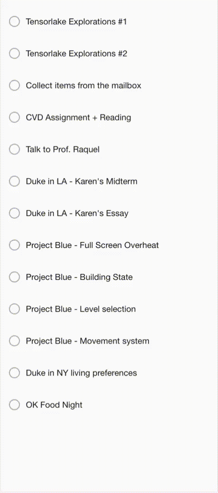

# todo-crumble

Text goes in, physics happens, letters pile up. A stick figure claims the summit.

A just-for-fun experiment with **Svelte 5** runes and **Matter.js** 2D physics — exploring how to make text disintegrate letter by letter and fall with realistic gravity, collisions, and friction.

## Demo

<!-- Replace with your recording: gif, mp4, or a link to a hosted video -->
<!-- Recommended: use a gif (< 10MB) or link to a video for larger recordings -->



## What happens

- Check off a line of text — it shatters into individual letters
- Each letter becomes a physics body with random velocity and spin
- Letters fall, bounce, and pile up at the bottom of the screen
- A stick figure walks to the top of the heap

## Tech Stack

- [Svelte 5](https://svelte.dev/) + [SvelteKit](https://svelte.dev/docs/kit) — runes reactivity, `$state.raw` for physics objects
- [Matter.js](https://brm.io/matter-js/) — 2D physics (gravity, collisions, sleeping bodies)
- [TypeScript](https://www.typescriptlang.org/)
- [Oxlint](https://oxc.rs/) + [Oxfmt](https://oxc.rs/) — linting and formatting

## Getting Started

```bash
pnpm install
pnpm run dev
```

Open [localhost:5173](http://localhost:5173) and start checking things off.

## Scripts

| Command | Description |
|---|---|
| `pnpm dev` | Start dev server |
| `pnpm build` | Production build (static) |
| `pnpm preview` | Preview production build |
| `pnpm check` | Svelte + TypeScript type checking |
| `pnpm lint` | Lint with oxlint |
| `pnpm fmt` | Check formatting with oxfmt |

## How It Works

1. `getBoundingClientRect()` captures the text position on screen
2. Each character becomes a Matter.js rigid body at that exact position
3. Bodies get random velocity and spin, then fall under gravity
4. A `requestAnimationFrame` loop syncs physics body positions to DOM elements
5. The stick figure tracks the highest settled letter and walks toward it

## License

MIT
